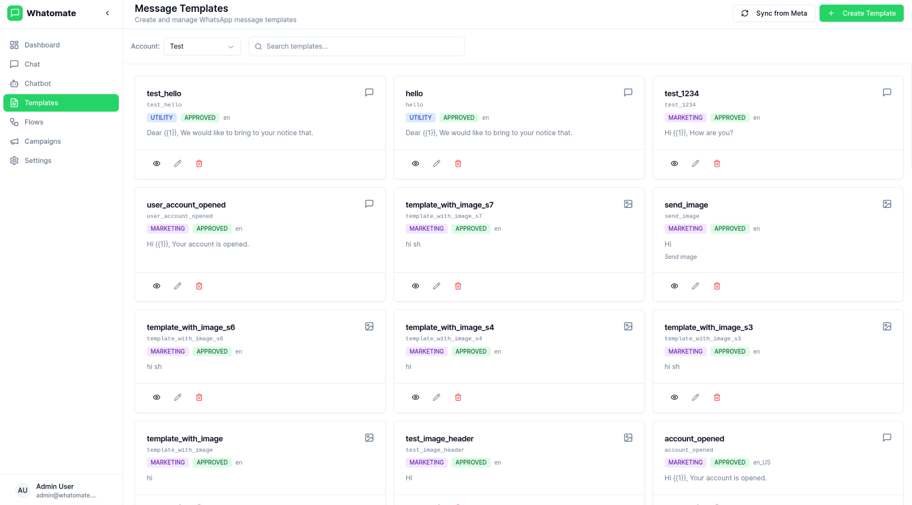
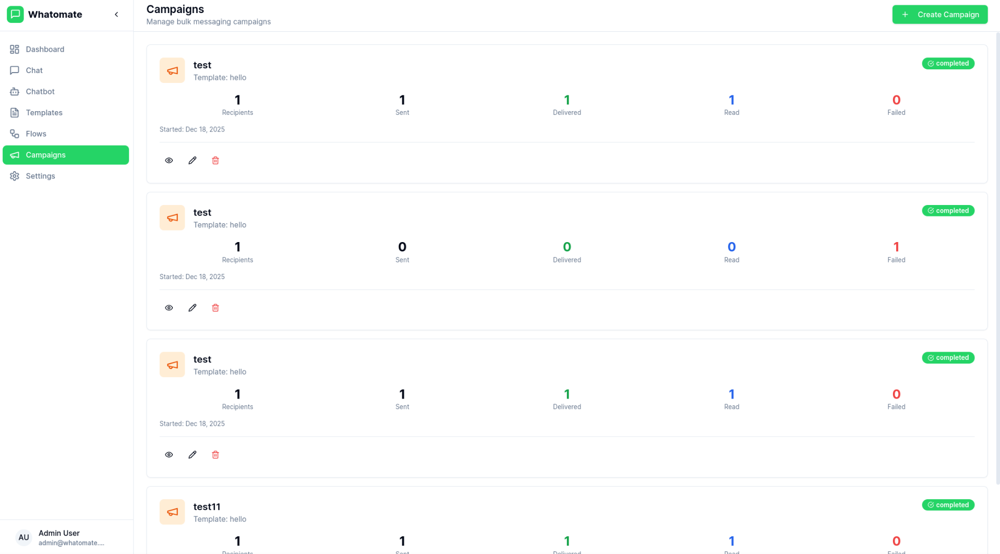

<a href="https://zerodha.tech"></a>

# Gowa-UI

Modern, open-source WhatsApp Business Platform. Single binary app.


## Features

- **Multi-tenant Architecture**
  Support multiple organizations with isolated data and configurations.

- **Granular Roles & Permissions**
  Customizable roles with fine-grained permissions. Create custom roles, assign specific permissions per resource (users, contacts, templates, etc.), and control access at the action level (read, create, update, delete). Super admins can manage multiple organizations.

- **WhatsApp Business API Integration**
  Connect via the WhatsApp Business API for messaging.

- **Real-time Chat**
  Live messaging with WebSocket support for instant communication. Conversation events (claimed, assigned, released, closed, reopened, collaborators joining or leaving) show their date and time in the timeline.

- **Private Conversations**
  Chats between your own numbers, plus any conversation moved there by hand, live in a separate Private tab. They are kept out of the customer queue, the daily reset and customer automations. Account-to-account chats show as one row with a "Send as" switch, and each user can hide the tab from their profile. See [docs/features/private-conversations.md](docs/features/private-conversations.md).

- **Template Management**
  Create and manage message templates approved by Meta.

- **Bulk Campaigns**
  Send campaigns to multiple contacts with retry support for failed messages.

- **Campaign Send Pacing**
  Per-account messages/minute budget enforced before every campaign send, protecting numbers from WhatsApp ban waves that target bursting accounts.

- **Business Hours & Auto-Reply**
  Each account can define its working window (with overnight spans and open days); inbound messages arriving while closed get your away message once per contact — no reply loops, groups excluded.

- **Device Health Alerts**
  When a connected number logs out or reconnects, the platform writes an audit entry, pushes a live in-app alert, and can notify an admin Telegram chat — no more silently-dead numbers.

- **WhatsApp Account Management**
  Connect and manage multiple WhatsApp accounts via GOWA (WhatsApp Web protocol) with user-specific visibility controls and granular device management.

- **Canned Responses**
  Pre-defined quick replies with slash commands (`/shortcut`) and dynamic placeholders.

- **Analytics Dashboard**
  Track messages, engagement, and campaign performance.

- **WhatsApp Status (Story)**
  Post text, image, and video WhatsApp Status updates from any connected account directly in the chat sidebar.

<details>
<summary>View more screenshots</summary>





</details>

## Installation

### Docker

The latest image is available on Docker Hub at [`compnew2006/gowa-ui:latest`](https://hub.docker.com/r/compnew2006/gowa-ui)

```bash
# Download compose file, sample config, and env file
curl -LO https://raw.githubusercontent.com/compnew2006/gowa-ui/main/docker/docker-compose.yml
curl -LO https://raw.githubusercontent.com/compnew2006/gowa-ui/main/config.example.toml
curl -L https://raw.githubusercontent.com/compnew2006/gowa-ui/main/docker/.env.example -o .env

# Copy and edit config
cp config.example.toml config.toml
# Edit .env to set PostgreSQL credentials and timezone

# Run services
docker compose up -d
```

Go to `http://localhost:8080` and login with `admin@admin.com` / `admin`

__________________

### Binary

Prebuilt binaries for six platforms are published on the [Releases page](https://github.com/compnew2006/gowa-ui/releases/latest). Each archive holds the `gowa-ui` binary (frontend embedded), `config.example.toml`, `README.md` and `LICENSE`.

| OS | CPU | Archive |
|---|---|---|
| Linux | x86-64 | `gowa-ui_<version>_linux_amd64.tar.gz` |
| Linux | ARM64 (aarch64) | `gowa-ui_<version>_linux_arm64.tar.gz` |
| macOS | Intel | `gowa-ui_<version>_darwin_amd64.tar.gz` |
| macOS | Apple Silicon (M-series) | `gowa-ui_<version>_darwin_arm64.tar.gz` |
| Windows | x64 | `gowa-ui_<version>_windows_amd64.zip` |
| Windows | ARM64 | `gowa-ui_<version>_windows_arm64.zip` |

The commands below install `1.0.0`; set `VERSION` to the latest release number. You also need PostgreSQL and Redis running and reachable from the machine.

#### Linux

```bash
VERSION=1.0.0
ARCH=amd64   # arm64 on ARM servers; check with `uname -m` (x86_64 = amd64, aarch64 = arm64)
NAME=gowa-ui_${VERSION}_linux_${ARCH}

curl -LO https://github.com/compnew2006/gowa-ui/releases/download/v${VERSION}/${NAME}.tar.gz
curl -LO https://github.com/compnew2006/gowa-ui/releases/download/v${VERSION}/checksums.txt
sha256sum --ignore-missing -c checksums.txt   # must print "<file>: OK"

tar -xzf ${NAME}.tar.gz
cd ${NAME}
sudo install -m 755 gowa-ui /usr/local/bin/gowa-ui
gowa-ui version
```

#### macOS

```bash
VERSION=1.0.0
ARCH=arm64   # Apple Silicon; amd64 on Intel Macs. Check with `uname -m` (arm64 or x86_64)
NAME=gowa-ui_${VERSION}_darwin_${ARCH}

curl -LO https://github.com/compnew2006/gowa-ui/releases/download/v${VERSION}/${NAME}.tar.gz
curl -LO https://github.com/compnew2006/gowa-ui/releases/download/v${VERSION}/checksums.txt
shasum -a 256 --ignore-missing -c checksums.txt   # must print "<file>: OK"

tar -xzf ${NAME}.tar.gz
cd ${NAME}
sudo mkdir -p /usr/local/bin
sudo install -m 755 gowa-ui /usr/local/bin/gowa-ui
gowa-ui version
```

The binary is not notarized. If you downloaded the archive with a browser instead of `curl`, macOS blocks it on first run; clear the quarantine flag with `xattr -d com.apple.quarantine gowa-ui` before installing.

#### Windows (PowerShell)

```powershell
$Version = "1.0.0"
$Arch = "amd64"   # "arm64" on ARM devices; check with $env:PROCESSOR_ARCHITECTURE (AMD64 or ARM64)
$Name = "gowa-ui_${Version}_windows_$Arch"
$Base = "https://github.com/compnew2006/gowa-ui/releases/download/v$Version"

Invoke-WebRequest "$Base/$Name.zip" -OutFile "$Name.zip" -UseBasicParsing
Invoke-WebRequest "$Base/checksums.txt" -OutFile checksums.txt -UseBasicParsing

# Verify the download: must print OK
$Expected = (Select-String -Path checksums.txt -SimpleMatch "$Name.zip").Line.Split(' ')[0]
$Actual = (Get-FileHash "$Name.zip" -Algorithm SHA256).Hash.ToLower()
if ($Actual -eq $Expected) { "OK" } else { "CHECKSUM MISMATCH - do not run this file" }

Expand-Archive "$Name.zip" -DestinationPath .
Set-Location $Name

# Install for the current user and add it to PATH (open a new terminal afterwards)
$Dest = "$env:LOCALAPPDATA\Programs\gowa-ui"
New-Item -ItemType Directory -Force $Dest | Out-Null
Copy-Item gowa-ui.exe $Dest
$UserPath = [Environment]::GetEnvironmentVariable("Path", "User")
if ($UserPath -notlike "*$Dest*") { [Environment]::SetEnvironmentVariable("Path", "$UserPath;$Dest", "User") }
& "$Dest\gowa-ui.exe" version
```

If you downloaded the zip with a browser, run `Unblock-File "$Name.zip"` before extracting so SmartScreen does not block the binary.

#### Configure and run (all platforms)

Run these from the extracted folder. The server reads `config.toml` from the current directory; pass `-config <path>` to use another location.

```bash
cp config.example.toml config.toml   # Windows: Copy-Item config.example.toml config.toml
```

Edit `config.toml` before the first start:

- In `[database]` and `[redis]`, set `host = "localhost"` (the example points at the Docker service names `db` and `redis`), plus the database user, password and name.
- For production, set:
  - `environment = "production"` and an `encryption_key` of 32+ characters.
  - A random `[jwt] secret`.
  - `[default_admin] email` and a `password` of 12+ characters.

Start the server; `-migrate` creates or updates the database schema:

```bash
gowa-ui server -migrate
```

Go to `http://localhost:8080`. With the example config (`environment = "development"`), log in as `admin@admin.com` / `admin`.

__________________

### Build from Source

```bash
git clone https://github.com/compnew2006/gowa-ui.git
cd gowa-ui

# Production build (single binary with embedded frontend)
make build-prod
./gowa-ui server -migrate
```

See [configuration docs](https://compnew2006.github.io/gowa-ui/getting-started/configuration/) for detailed setup options.

## CLI Usage

```bash
./gowa-ui server              # API + 1 worker (default)
./gowa-ui server -workers=0   # API only
./gowa-ui worker -workers=4   # Workers only (for scaling)
./gowa-ui version             # Show version
```

## Developers

The backend is written in Go ([Fastglue](https://github.com/zerodha/fastglue)) and the frontend is Vue.js 3 with shadcn-vue.
- If you are interested in contributing, please read [CONTRIBUTING.md](./CONTRIBUTING.md) first.

```bash
# Development setup
make run-migrate    # Backend (port 8080)
cd frontend && npm run dev   # Frontend (port 3000)
```

Frontend unit tests use Vitest, Vue Test Utils, and jsdom. The test tooling
requires Node.js 22.22.2+ on the 22.x line, 24.15.0+ on the 24.x line, or 26+.
Place unit tests under `frontend/src/` with a `.test.ts` or `.spec.ts` suffix.

```bash
cd frontend
npm run typecheck
npm run test:unit          # Run unit tests once
npm run test:unit:watch    # Watch unit tests during development
npm run test:e2e           # Run Playwright end-to-end tests
```

## License

See [LICENSE](LICENSE) for details.
